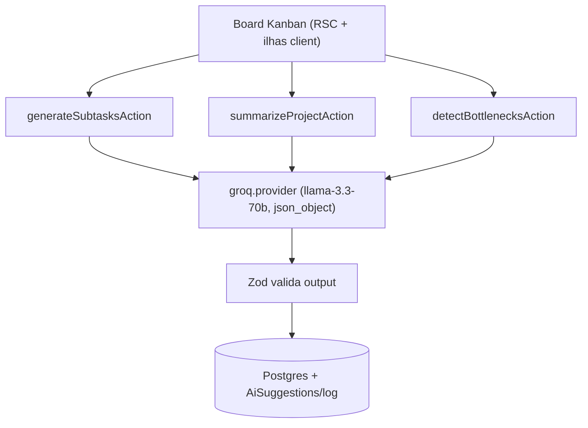
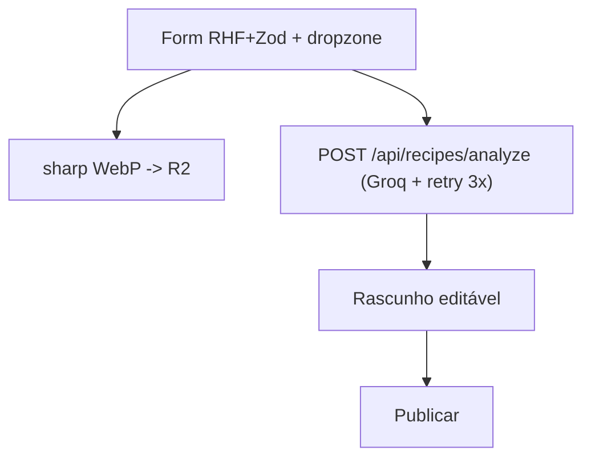
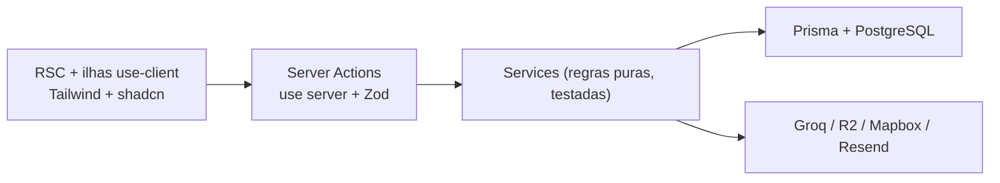

<div align="center">

# Douglas Maciel

**Full-Stack Developer & UX Designer · Next.js (App Router, Server Actions, TypeScript, Tailwind) + LLMs**

[](https://www.linkedin.com/in/douglas-maciel-4943461b0/)
[](https://github.com/MacielDouglas)
[](https://macield.vercel.app/)

</div>

---

## Sobre

Desenvolvedor full-stack com +5 anos de experiência. Construo **produtos web reais em produção** com **Next.js 16 (App Router, Server Components, Server Actions), React 19, TypeScript estrito e Tailwind CSS v4** — integrados a **LLMs (Groq) e sistemas autônomos de regras** (rate-limit, logging, fairness algorítmico, offline-first).

Padrão que repito em todo projeto: **UI → Server Action (Zod) → Service → Prisma + PostgreSQL → LLM com output validado → log/rate-limit**. IA sempre como **co-piloto com revisão humana**, nunca veredito fechado.

```
💼 Aberto a freelas premium e times de produto
📍 Ipojuca, Pernambuco — Brasil
🌐 https://macield.vercel.app/
```

---

## Stack principal

| Camada | Escolha |
|---|---|
| Framework | Next.js 16 (App Router, RSC, Server Actions, `proxy.ts`) · React 19 |
| Linguagem | TypeScript 5 (strict) |
| UI | Tailwind CSS v4 · shadcn/ui · Radix UI · lucide-react · Framer Motion |
| Dados | Prisma 7 + PostgreSQL (Neon, `@prisma/adapter-pg`) · Drizzle (Meeting) · Zod 4 |
| Auth | Better Auth (senha + Google OAuth) · RBAC por organização |
| IA | Groq SDK (`llama-3.3-70b`, `gpt-oss-120b`) · `json_object` + validação Zod · rate-limit por user · log estruturado (Pino) |
| Storage/Infra | Cloudflare R2 (S3) + sharp · Resend · Mapbox GL · Vercel · Bun |
| Qualidade | Vitest · Playwright (POM + axe-core) · Biome/ESLint · `tsc --noEmit` · Husky |

---

## Projetos em destaque

### 🤖 1. [OrquestraAI](https://github.com/MacielDouglas/OrquestraAI) — Kanban com IA sênior no fluxo

[](https://orquestra-ai.vercel.app)
[](https://nextjs.org)
[](https://groq.com)
[](https://github.com/MacielDouglas/OrquestraAI/tree/main/tests/e2e)

Board Kanban onde a IA atua como membro sênior: **gera subtarefas, resume o projeto e detecta gargalos** sob demanda — com rate-limit por usuário e logging de modelo/latência/tokens.



**Decisões de design/UX:** IA como rascunho editável; server-first com `revalidatePath`; dark mode + WCAG AA (axe-core em CI); sidebar desktop / bottom-nav mobile.
**API/Actions:** `generateSubtasksAction`, `summarizeProjectAction`, `detectBottlenecksAction` — Result pattern `{ data, error }`, Zod antes de qualquer I/O, `requireSession()` + ownership.

### 🍳 2. [Queimando Panela](https://github.com/MacielDouglas/queimando_panela) — receitas com IA co-piloto

[](https://queimandopanela.vercel.app)

Comunidade de receitas brasileiras: você escreve como faz em casa, a **IA confere (utensílios, nutrição, tempo, categoria)** e você revisa e publica. Rota `/o-que-tem`: a IA sugere receitas da sua geladeira (3/dia, rate-limit no backend).



**Decisões:** mel queimado ≤10% da tela, cards sem sombra, linha 65–72ch, toque 44px. **API:** `POST /api/recipes/analyze`, `POST /api/geladeira/generate`.

### 🗓️ 3. [Meeting](https://github.com/MacielDouglas/Meeting) — sistema autônomo de escala

[](https://meeting-pearl.vercel.app)

Programa semanal + designações por elegibilidade + **rodízio de limpeza em 8 passadas com fairness de 90 dias** (família atômica, fallbacks com aviso). Parser real de `.jwpub`, PWA Serwist + IndexedDB offline, impressão A4, feed iCal. **480 testes Vitest.**

### 🗺️ 4. [DireccionesV3](https://github.com/MacielDouglas/direccionesV3) — evolução 2024–2026 até produção

[](https://direcciones.vercel.app)

Plataforma multi-tenant de endereços: React → Next.js 16, GraphQL → Prisma. Cards com rota Mapbox, levantamento colaborativo de pins, PWA com cache agressivo para campo com rede ruim. Fluxo **UI → Server Action → Service → Prisma**, RBAC owner/admin/member validado no servidor.

---

## Arquitetura padrão (todos os repos)



Regras: páginas server-first com `Promise.all`, `Suspense` + skeleton por aba, client recebe só flags (`canManage`), zero supressão de lint, testes cobrindo domínio.

---

## Documentação por repo

Cada repositório destacado contém: diagrama de arquitetura (mermaid), seção **Decisões Técnicas / Design**, tabela de **API / Server Actions** e instruções de run local (`bun install` → `.env` → `prisma migrate deploy` → `bun run dev`). Detalhes de produto em `PRODUCT.md` e de design em `DESIGN.md`.

---

## 📊 GitHub Stats

<div align="center">
  
  
</div>

---

<div align="center">

**Vamos conversar?**

[](https://www.linkedin.com/in/douglas-maciel-4943461b0/)

</div>
