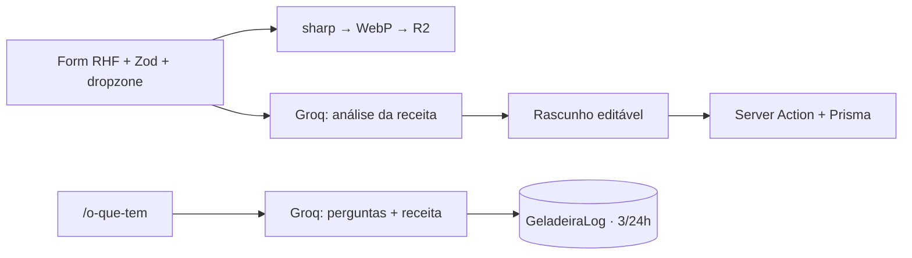
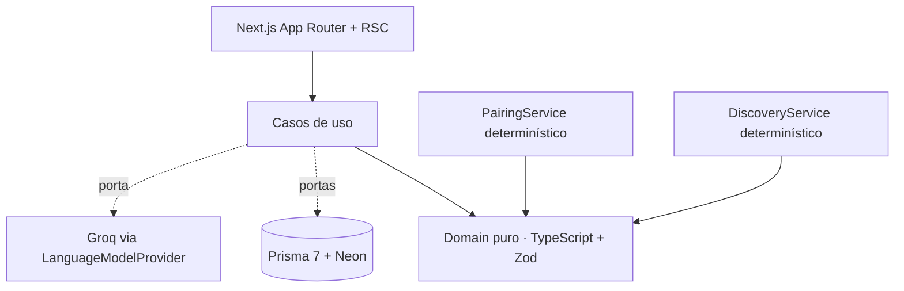

# Douglas Maciel

### Desenvolvedor Full-Stack · Next.js · TypeScript · PostgreSQL · IA aplicada

Construo produtos web de ponta a ponta: da descoberta e do design system ao banco, autenticação, integração com LLM, testes e deploy.

📍 Ipojuca, Pernambuco · 🌐 Remoto ou híbrido · 💼 Aberto a oportunidades full-stack

---

## Resumo para recrutadores

Sou desenvolvedor full-stack com **5+ anos construindo produtos web** e foco em produto. Meu diferencial não é apenas usar Next.js: é entregar o fluxo inteiro — **UI acessível, Server Actions validadas, modelagem de dados, IA com revisão humana, testes automatizados e CI** — com decisões documentadas e qualidade verificável.

- **Produto ponta a ponta:** conduzi descoberta, desenhei, implementei e publiquei plataformas com autenticação, banco relacional, upload de imagens, busca, painel administrativo e deploy.
- **IA com engenharia, não oráculo:** LLM atrás de contratos, saída validada, fallback determinístico, rate-limit e o servidor sempre como fonte da verdade.
- **Qualidade que roda no CI:** TypeScript estrito, lint/format, testes unitários, E2E e auditoria de acessibilidade bloqueando regressões.

> Os dois projetos abaixo foram escolhidos para mostrar **duas arquiteturas diferentes** — um monólito Next.js feature-based e um monólito modular DDD — com a mesma régua de qualidade.

---

## Projetos em destaque

### 🍳 01 · Queimando Panela — receitas brasileiras com IA co-piloto

**O problema:** receitas de família se perdem, blogs tradicionais priorizam anúncio sobre leitura e o cozinheiro amador não tem um lugar que trate sua culinária com respeito — nem uma análise confiável para publicar sem medo.

**A solução:** um acervo vivo onde cada receita tem **dono, história e medidas de "colher de pau"**. Ao criar uma receita, a IA atua como co-piloto e devolve um **rascunho editável** com utensílios, nutrição, tempos, categoria, dificuldade e sugestões. A rota `/o-que-tem` vai além: sugere uma receita com o que a pessoa já tem em casa, fazendo até duas perguntas de sim/não antes de gerar.

| Atributo | Como aparece no produto |
|---|---|
| **Descoberta** | Home com destaques, últimas e clássicas; `/receitas` com filtros por tipo, utensílio e ingrediente, busca e paginação; detalhe com ingredientes, passos, nutrição, história e galeria. |
| **Editor com IA** | React Hook Form + Zod, upload drag-and-drop, `sharp` gerando variantes WebP para o Cloudflare R2 e análise via Groq. Nada é publicado sem revisão humana. |
| **`/o-que-tem`** | A IA pergunta até duas vezes e então gera a receita. A quota é real: **3 receitas por 24 h por usuário**, persistida em `GeladeiraLog`, com `429` e `Retry-After`. |
| **Conta e autoria** | Better Auth (e-mail/senha + Google OAuth opcional), recuperação de senha via Resend, rotas privadas e checagem de ownership nas mutações. |
| **Operação** | Prisma 7 + PostgreSQL, 15 modelos, migrações versionadas, validação de ambiente e headers de segurança (HSTS, `X-Frame-Options`, `nosniff`, `Permissions-Policy`). |

**Diferenciais**

- **IA como rascunho, nunca veredito.** O prompt preserva a quantidade de passos e o estilo do autor; o backend extrai JSON mesmo de respostas sujas, normaliza a numeração e valida a entrada e a saída antes de qualquer escrita.
- **Receita com dono e história.** Seções, ingredientes normalizados (`generalName` para busca), utensílios N:N, imagens com metadados e publicação controlada — o domínio representa a culinária real, não um formulário genérico.
- **Design editorial com regra.** Sistema *Epirus*: papel `#f6f0e4`, tinta `#1b2920`, barro `#a85131`, ouro `#c4975d`, Fraunces + DM Sans. Barro apenas em números, links e CTAs — nunca como fundo de página inteira —, foco visível de 3 px, alvos de 44 px, `prefers-reduced-motion` e WCAG 2.1 AA como princípio.

**Qualidade em números:** 65 arquivos de teste · **275 testes Vitest** · **8 E2E Playwright** com setup de autenticação · Biome + `tsc --noEmit` + cobertura + build + E2E no CI · **171 commits** entre 2024 e 2026.

---

### ☕ 02 · Café Bourbon — e-commerce editorial com DDD modular (demo)

**O problema:** escolher café especial é opaco, harmonizações costumam ser tratadas como opinião sem critério e uma LLM solta pode inventar produto, preço ou disponibilidade.

**A solução:** uma casa de café que **explica cada recomendação**. O catálogo mostra perfis sensoriais, o motor de harmonização é determinístico e auditável, a descoberta parte do paladar do visitante e o barista virtual só pode citar produtos que existem no banco.

| Atributo | Como aparece no produto |
|---|---|
| **Catálogo** | 4 cafés reais (Brasil, Cubano, Papua Nova Guiné e Colombiano Medellín), queijos e vinhos de demonstração no seed, filtros, ficha sensorial e comparação. |
| **Harmonização** | Score 0–100 com pesos explícitos: intensidade 30, corpo 20, acidez 15, notas em comum 20, contraste 10 e disponibilidade 5. Cada parcela é exibida com `rule`, `points` e `detail`; trio tem bônus por nota que liga os três. |
| **Descoberta** | Questionário de paladar com score determinístico, faixas de afinidade e fallback editorial quando não há resultado. |
| **Barista com IA** | Groq **somente no servidor**, atrás de `LanguageModelProvider`. O contexto vem de catálogo + pairing; produtos citados são resolvidos no banco; preço e estoque nunca vêm do modelo. Rate-limit de 10 req/min/IP e fallback útil sem chave. |
| **Commerce e admin** | Carrinho com preço sempre calculado no servidor, kits com desconto, planos de assinatura, painel do owner com produtos, estoque, imagens e vendas. Escopo demonstrativo explícito: sem pagamento real. |

**Diferenciais**

- **Explicabilidade acima de magia.** Toda harmonização mostra os critérios que produziram o score. É heurística do sistema, apresentada como heurística — não como verdade científica.
- **IA com trilho de segurança.** O modelo nunca decide preço, disponibilidade ou IDs; a saída é validada contra o catálogo e existe fallback determinístico. Em um e-commerce, isso é requisito, não detalhe.
- **Arquitetura que sobrevive à demo.** `domain/` não importa Next, React, Prisma nem Groq; `application/` depende de portas; `infrastructure/` implementa adaptadores. Fakes permitem testar regras sem banco.

**Qualidade em números:** **107 testes Vitest** · **89 E2E Playwright** · auditoria **axe-core** em rotas públicas, diálogos, carrinho e quiz · CSP + HSTS · env validado com Zod · Neon pooled para runtime e unpooled para migrations.

**Design:** sistema *Casa Bourbon* — espresso, creme de linho e bordô raro, Geist, escala sensorial como componente-assinatura, sombras ambientes, movimento reduzido e WCAG 2.1 AA como critério verificável.

---

### Comparativo rápido

| Dimensão | Queimando Panela | Café Bourbon |
|---|---|---|
| **Arquitetura** | Feature-based + Server Actions | Monólito modular DDD + ports/adapters |
| **IA** | Análise de receita + geração pela geladeira | Barista restrito ao catálogo verificado |
| **Qualidade** | 275 unitários + 8 E2E | 107 unitários + 89 E2E + axe |
| **Design** | Editorial *Raízes* (Fraunces + DM Sans) | Editorial *Casa Bourbon* (Geist + espresso/bordô) |
| **O que prova** | Velocidade de produto e IA com revisão humana | Rigor arquitetural e explicabilidade |

---

## Outros projetos

| Projeto | O que demonstra |
|---|---|
| [**OrquestraAI**](https://github.com/MacielDouglas/OrquestraAI) · [demo](https://orquestra-ai.vercel.app) | Kanban em que a IA atua como membro sênior: gera subtarefas, resume o projeto e detecta gargalos. Server Actions com Result pattern, Zod, rate-limit por usuário, logging de modelo/latência/tokens e **63 E2E**. |
| [**Meeting**](https://github.com/MacielDouglas/Meeting) · [demo](https://meeting-pearl.vercel.app) | Sistema autônomo de escala semanal com elegibilidade, rodízio de limpeza em 8 passadas e **fairness de 90 dias**. Parser de `.jwpub`, PWA offline com IndexedDB, impressão A4, feed iCal e **480 testes Vitest**. |
| [**DireccionesV3**](https://github.com/MacielDouglas/direccionesV3) · [demo](https://direcciones.vercel.app) | Plataforma multi-tenant de endereços em evolução 2024–2026: React → Next.js 16, GraphQL → Prisma, rota Mapbox, pins colaborativos e PWA para campo com rede ruim. RBAC validado no servidor. |

> Cada repositório tem README com diagrama de arquitetura, decisões técnicas, tabela de API/Server Actions e instruções de execução local.

---

## Evolução 2021 → 2026

Considerando os projetos de produto publicados neste perfil, o primeiro foi o **Café Bourbon**, em 2022: HTML, CSS, Bootstrap e Firebase. O mais recente é o **Café Bourbon 2.0**, em 2026: Next.js 16, React 19, TypeScript estrito, DDD modular, Prisma/Neon, Better Auth, Groq e **196 testes automatizados**.

A mesma marca. Outro patamar de engenharia.

| Ano | Marco | O que mudou na prática |
|---|---|---|
| **2021** | Fundamentos e primeiros repositórios | HTML, CSS, JavaScript, Angular, Java, C#, SQL e lógica. A base que permitiu escolher stack com critério. |
| **2022** | Primeiro projeto real: Café Bourbon v1 | HTML/CSS/Bootstrap/Firebase. Aprendi a publicar; ainda não sabia sustentar, testar ou evoluir com segurança. |
| **2023** | React, Node e APIs | Full Stack Open, React, GraphQL, MongoDB e React Native. Primeiros estados complexos, consumo de API e deploy. |
| **2024** | Nasce o Queimando Panela | Next.js + TypeScript + Prisma + PostgreSQL + autenticação + IA. O projeto evoluiu continuamente entre 2024 e 2026, com 171 commits. |
| **2025** | IA em produto com OrquestraAI | IA como membro do fluxo, Server Actions, Zod, rate-limit, logs estruturados e 63 E2E. |
| **2026** | Engenharia de produto | DDD modular, offline-first, fairness algorítmico, acessibilidade AA e logs sem segredos. O Café Bourbon 2.0 fecha o ciclo. |

### Antes → depois: Café Bourbon

| Dimensão | 2022 (v1) | 2026 (v2) |
|---|---|---|
| **Frontend** | HTML + Bootstrap vendored | Next.js 16 + React 19 + Tailwind 4 + Base UI |
| **Backend** | Nenhum | Route Handlers + casos de uso + Prisma 7 + Neon |
| **Domínio** | Não existia | 5 contextos DDD com domínio puro em TypeScript + Zod |
| **IA** | Não existia | Groq atrás de porta, validação contra o catálogo e fallback |
| **Qualidade** | Sem testes | 107 Vitest + 89 E2E + axe-core |
| **Segurança** | Formulário coletava cartão sem backend | Auth, CSP/HSTS, preço no servidor e escopo demo explícito |
| **Acessibilidade** | `alt` vazio, sem foco visível | WCAG 2.1 AA como critério + auditoria automatizada |

---

## Stack principal

| Camada | Escolhas |
|---|---|
| **Framework** | Next.js 16 (App Router, RSC, Server Actions) · React 19 |
| **Linguagem** | TypeScript estrito · Zod |
| **UI** | Tailwind CSS 4 · shadcn/Base UI · Radix UI · lucide-react · Framer Motion |
| **Dados** | Prisma 7 · PostgreSQL (Neon, `@prisma/adapter-pg` / `@prisma/adapter-neon`) |
| **Auth** | Better Auth (e-mail/senha + Google OAuth) · ownership e áreas protegidas no servidor |
| **IA** | Groq (`gpt-oss-120b`, `llama-3.3-70b`) · JSON validado · fallback · rate-limit |
| **Infra** | Vercel · Cloudflare R2 (S3) · `sharp` · Resend · Mapbox GL · Bun |
| **Qualidade** | Vitest · Playwright · axe-core · Biome/ESLint · `tsc --noEmit` · GitHub Actions |

---

## Como eu trabalho

1. **Servidor é a fonte da verdade.** Preço, disponibilidade, permissões e produtos citados nunca vêm do cliente nem do LLM.
2. **IA é co-piloto, não oráculo.** Saída estruturada, validação, fallback e revisão humana. Quando não há certeza, o produto deve dizer isso.
3. **Qualidade é requisito, não fase final.** Typecheck, lint, testes e acessibilidade rodam no CI — não só no meu terminal.
4. **Design tem regra e acessibilidade tem teste.** Tokens, contraste, foco visível, alvos de toque e `prefers-reduced-motion` fazem parte da entrega.

---

## 📊 Atividade recente

---

## Vamos conversar?

Aberto a oportunidades **full-stack** e **product engineering**, com espaço para construir produtos sérios e IA aplicada com responsabilidade.

